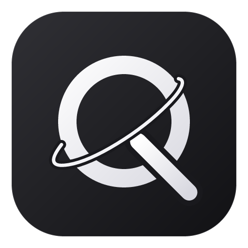

<div align="center">
  
  <h1>Quasar</h1>
  <p><strong>A browser and work environment for you and your agents.</strong></p>
  <p>
    <a href="https://github.com/fordft/Quasar">Source</a> ·
    <a href="docs/README.md">Documentation</a> ·
    <a href="https://github.com/fordft/Quasar/issues">Issues</a>
  </p>
</div>

Quasar is an open-source desktop browser forked from
[Zephium](https://github.com/zephium-browser/Zephium), created by
[crynta](https://github.com/crynta). It combines everyday browsing with an AI
assistant and a persistent workspace for agent-assisted work.

## Browse, Ask, Work

- **Browse:** vertical tabs, spaces, profiles, split views, native ad and tracker
  blocking, Chrome-extension compatibility, notes, tasks and focus tools.
- **Ask Quasar:** ask about open pages, follow citations, open links, take bounded
  actions on a page, and propose CSS changes to a site.
- **Work:** describe an outcome, let helpers work on its parts, and keep results
  on a canvas as documents, tables, charts, plans and other structured objects.
  Work includes 25 built-in skills and connections to configured MCP servers.

AI connects through **Sign in with ChatGPT**. Eligible ChatGPT Plus and Pro
accounts can authorize plan usage without API keys. Quasar calls OpenAI's
public API directly; the upstream Zephium account, billing service, provider
keys and local model endpoints have been retired. See [ChatGPT setup and
implementation notes](docs/chatgpt.md). Linux currently remains a browsing-only preview.

General shell execution and coding-agent hand-offs are currently gated in the
source pending a confined native runner. Some platform-specific capabilities
have additional qualification requirements. The code and tests determine
availability; upstream documentation may describe a broader target.

## Platforms and architecture

- **macOS:** Apple Silicon, using WebKit. Requires an updated macOS and Safari
  that meet the application's runtime security policy.
- **Windows:** x64, Windows 10 or 11, using WebView2.
- **Linux preview:** x86_64, Ubuntu 26.04 or newer (glibc 2.43+), distributed as
  an AppImage with WebKitGTK included. Browsing is available; AI and Work are
  disabled while their Linux backend is unfinished.

Download test builds from [Releases](https://github.com/fordft/Quasar/releases).
See [preview installation and release workflow](docs/preview-builds.md) for
platform requirements, installation and development details.

Rust owns browser state, native integrations, storage and agent execution.
Tauri and Wry host the native WebViews. The interface uses Svelte 5, TypeScript,
Vite and Tailwind CSS. Untrusted websites use WebViews separated from the
privileged application interface.

See [architecture](docs/architecture.md), [frontend conventions](docs/frontend.md)
and the [security model](docs/security-model.md). Internal `zephium-*` crate
names and IPC contracts retain their upstream names for compatibility.

## Develop

Install the toolchain pinned in [rust-toolchain.toml](rust-toolchain.toml), the
Node.js version in [.node-version](.node-version), pnpm through Corepack, and
the native Tauri prerequisites for your platform.

```sh
git clone https://github.com/fordft/Quasar.git
cd Quasar
pnpm install --frozen-lockfile
pnpm dev
```

Quasar uses `app.quasar` for installed builds and `app.quasar.dev` for development,
separate from Zephium's application profiles. Existing Zephium data is not
moved or adopted automatically.

Automatic updates are disabled until Quasar has its own signing key and update
endpoint. Builds do not install releases from the upstream Zephium project.

## Branding and checks

The source icon and wordmark live in [assets/brand](assets/brand). Regenerate
the native and frontend assets with:

```sh
pnpm brand:assets
```

Installer artwork is regenerated with `pnpm -C frame installer-art` after
changing the wordmark or sky. Frontend verification uses:

```sh
pnpm -C frame check
pnpm -C frame test:component
pnpm -C frame build
cargo xtask check-frame-styles
```

See [CONTRIBUTING.md](CONTRIBUTING.md) for the inherited development workflow.
Documents describing the upstream project retain their historical references
and do not establish a separate Quasar service or support channel.

## Credits and license

Quasar builds on Zephium and preserves the upstream authors' copyright and
license notices. The source is licensed under [MPL-2.0](LICENSE).
Bundled EasyList and EasyPrivacy data retain their
[CC BY-SA 3.0 license and notices](assets/blocker-seed/v1/NOTICE).
The wordmark's DejaVu-derived outlines retain their
[font license](assets/brand/WORDMARK-LICENSE.txt).
